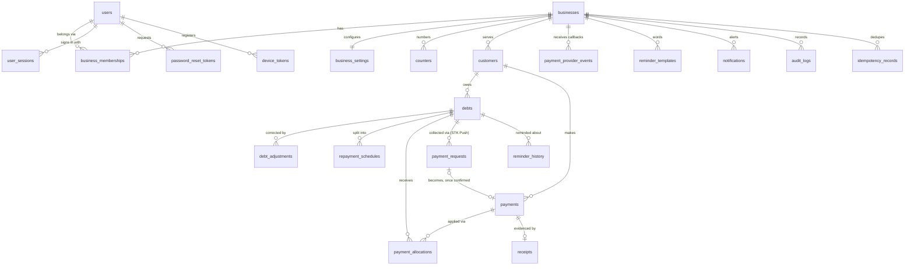

# Database schema

Source of truth: `backend/app/models/__init__.py` and the Alembic migrations in
`backend/migrations/versions/` (`0001` creates the 22 tables, `0002` adds PostgreSQL
row-level security). `alembic check` confirms the migrations match the models.

## Conventions

- Primary keys are UUIDs, so clients cannot enumerate other records.
- Every tenant-owned table has a `business_id` foreign key and an index on it.
- Money is `NUMERIC(14,2)` and handled as `decimal.Decimal`; it is never a float.
- Timestamps are `TIMESTAMPTZ` stored in UTC. A custom column type rejects naive datetimes,
  so the behaviour is identical on SQLite and PostgreSQL.
- Business dates (`incurred_on`, `due_date`) are `DATE` values in the business's time zone (Africa/Nairobi).
- Posted financial rows are never updated in place or deleted. Corrections are adjustments
  (debts) or reversals (payments).

## Entity relationships



## Tables

| Table | Purpose | Key constraints |
|---|---|---|
| `businesses` | Tenant: name, contact, currency (KES), time zone | — |
| `users` | People who sign in; Argon2id password hash | `email` unique |
| `business_memberships` | User ↔ business with role `owner`/`admin`/`cashier`, active flag | unique (`business_id`, `user_id`) |
| `user_sessions` | Refresh-token sessions (SHA-256 of token), expiry, revocation | `refresh_token_hash` unique |
| `password_reset_tokens` | One-time reset codes (hashed), expiry, used-at | `token_hash` unique |
| `device_tokens` | Push tokens per user | `token` unique |
| `business_settings` | Reminder offsets/channels/quiet hours/weekly cap, cashier permissions, enabled payment methods | PK = `business_id` |
| `counters` | Per-business gapless sequences (customer, debt, `receipt:<year>`) | PK (`business_id`, `name`) |
| `customers` | Name, E.164 phone, optional email/address/notes, `active`/`archived`, SMS opt-in, `version` for optimistic locking | unique (`business_id`, `customer_number`), unique (`business_id`, `client_reference`) |
| `debts` | Principal, dates, terms, reference, `flag` (`none`/`cancelled`/`disputed`), `version` | `principal > 0`, `due_date >= incurred_on`, unique number and `client_reference` per business |
| `debt_adjustments` | Signed corrections (e.g. returned goods = negative) with reason | `amount <> 0` |
| `repayment_schedules` | Installments: number, due date, amount (must sum to principal) | unique (`debt_id`, `installment_number`), `amount > 0` |
| `payments` | Amount, method, paid-at, external reference, verification status, posted/reversed, reversal reason/by/at, receipt number | `amount > 0`; unique `client_reference` per business; **partial unique index** on (`business_id`, `method`, `external_reference`) where `status='posted'` |
| `payment_allocations` | How a payment is split across debts | unique (`payment_id`, `debt_id`), `amount > 0` |
| `receipts` | Receipt number plus an immutable JSON snapshot of what was issued | unique (`business_id`, `receipt_number`); `payment_id` unique |
| `payment_requests` | STK Push requests: amount, phone, provider mode, status (`pending`/`succeeded`/`failed`/`needs_review`) | `checkout_request_id` unique |
| `payment_provider_events` | Every provider callback received, with outcome | unique (`provider`, `event_key`): repeated callbacks are processed once |
| `reminder_templates` | Per-business message text for upcoming / due today / overdue | unique (`business_id`, `kind`) |
| `mpesa_sms_messages` | Each M-Pesa "received" SMS read on the owner's phone: code, amount, payer name and (possibly masked) number, outcome, customer, payment. The owner's M-Pesa balance is redacted from the stored text | unique (`business_id`, `transaction_code`): one SMS is applied at most once |
| `customer_mpesa_names` | Names M-Pesa shows for a customer's payments, learned when staff matched one by hand; the payment it was learned from; who matched it | unique (`business_id`, `customer_id`, `name`); index (`business_id`, `name`) |
| `reminder_history` | Every planned reminder: channel, target date, offset, status, attempts, last error, next attempt | `idempotency_key` unique = (debt, target date, offset, channel) |
| `notifications` | In-app alerts for staff | `dedupe_key` unique |
| `audit_logs` | Who did what, before/after JSON, reason, IP | index (`business_id`, `created_at`) |
| `idempotency_records` | Stored responses for `Idempotency-Key` replays | unique (`business_id`, `user_id`, `key`) |

## Derived values (not stored)

Balances and statuses are computed from the ledger on every read
(`app/repositories/debts.py`, rules in `app/services/ledger.py`):

```
total_due   = principal + Σ adjustments
paid        = Σ allocations of POSTED payments with verification ∈ {verified, not_required}
pending     = Σ allocations of POSTED payments with verification = pending
balance     = total_due − paid
allocatable = balance − pending          (the most a new payment may add)
status      = cancelled | disputed  (manual flags)
            | paid            if balance ≤ 0
            | overdue         if any amount is past its due date / installment date
            | partially_paid  if paid > 0
            | open
```

Not caching balances means a report can never disagree with the ledger. The cost is that
lists compute balances for the whole business on each request, which is fine for
thousands of debts. Beyond that, see "Scaling" in `architecture.md`.

## Row-level security (PostgreSQL)

Migration `0002` enables and **forces** RLS on the 15 tenant tables, with the policy:

```sql
current_setting('app.bypass_rls', true) = 'on'
OR business_id::text = current_setting('app.business_id', true)
```

The API sets `app.business_id` at the start of every transaction, after verifying
membership (`app/db.py`). Only trusted system code (the scheduler, provider callbacks
and the seed script) sets the bypass. `users`, `business_memberships` and `businesses` are
not under RLS because sign-in must read them before a tenant is known; access to them is
restricted in the application layer.
